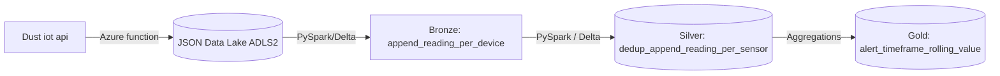
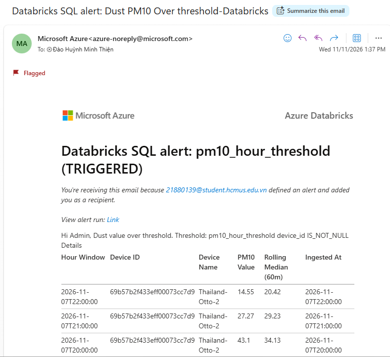
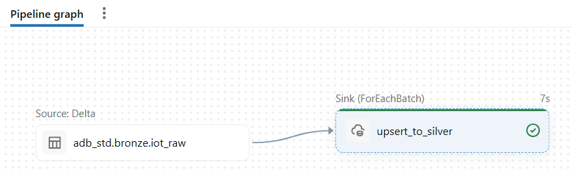

# 🚦 [AZ_ADB_IOT] Dust IOT Lakehouse Pipeline

An end to end Medallion data pipeline from api to take action on threshold violation of dust

## Mission

- In factory environment, **Dust over threshold** and spike cause **high defect cost** as well as automatic trigger **false alarm**
- This pipeline aims to use **minimal resources** to alert per aligned timeframe on **smooth sensor data**.
- It starts from collect **api iot data**, process it with traceability , calculate technical value and trigger alert to email on threshold violation.

## 📍 Architecture

  ---
## 🔍 Key thoughts

| Stage  | Input  |Plan  | Thoughts  | Code Reference |
| --- | ---| --- | --- | ---|
| **Source** | data update every 3 min  from https://api.opensensemap.org/ | 1. Get data by period  2. Land to data lake                                                  | 1. API update lag from measured time 2. Align with alert timeframe to save cost   | [Azure_Function](src/AzFxIngestAPI) |
| **Bronze** | JSON files periodly  | 1. append raw to delta format 2. add metadata   | 1. reduce cost re-read vast json files 2. create single copy of source change  | [Bronze Code](src/dust_stream_elt/src/pipe_dust_stream_elt)|
| **Silver** | Raw ingest data including history                              | 1. explode JSON array to long format 2. clean data ready for analytics                       | 1. analytics use need long tabular format per measurement type ( humid, PM10 dust) 2. pipeline stable per re-run with deduplicate | [Silver Code](src/dust_stream_elt/src/pipe_dust_stream_elt)|
| **Gold**   | Long multi measurement big data                                | 1. tranform into needed data with rolling by alert timeframe                                 | 1. apply logic to serve business case 2. reduce cost on self-serve analytics                                                         | [Gold Code](src/dust_stream_elt/src/pipe_dust_stream_elt) |
| **Alert**  | Aggregated information periodly                                | 1. set alert for over theshold using SQL 2. send business formatted mail  for take action | 1. need actionable trigger to serve business  | [Alert Code](src/dust_stream_elt/src/pm10_hour_threshold.dbalert.json) |
